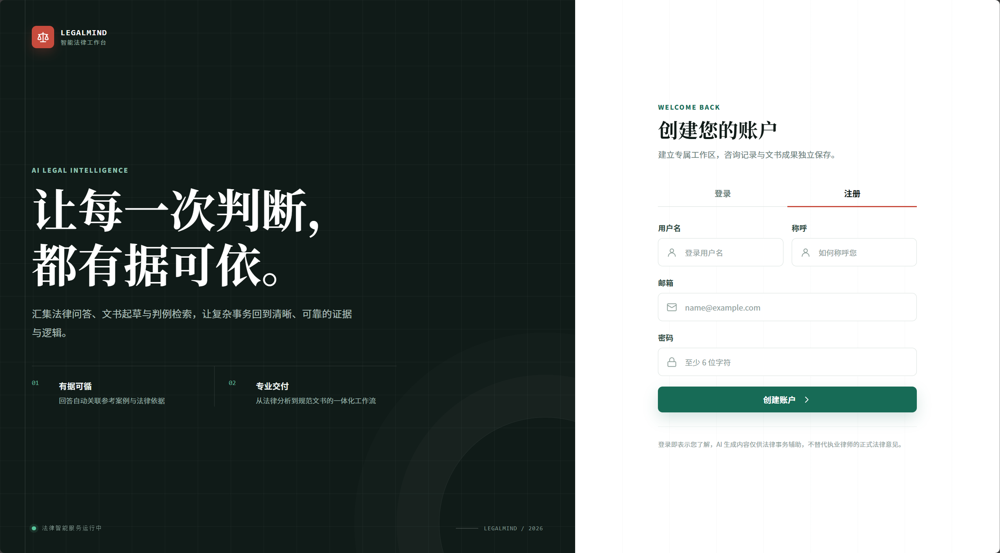
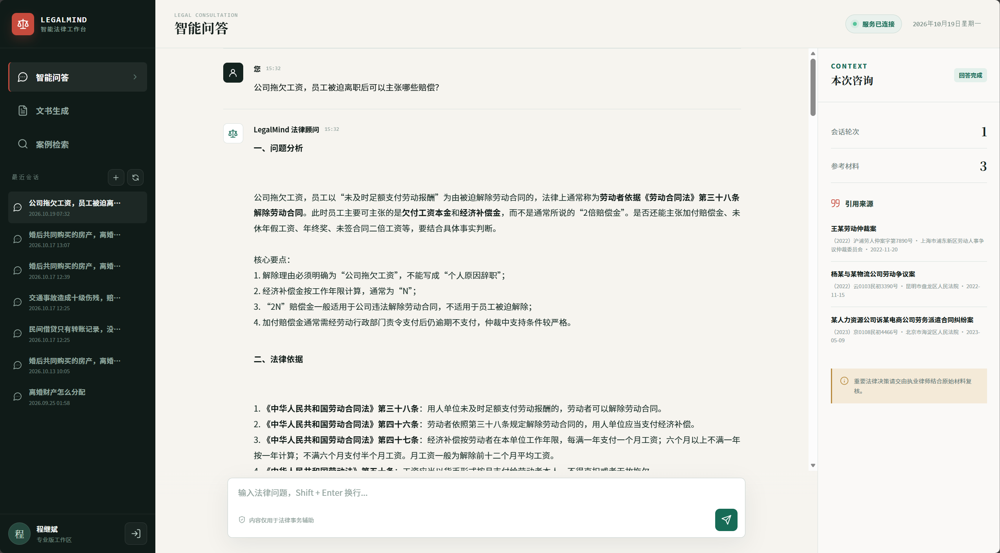
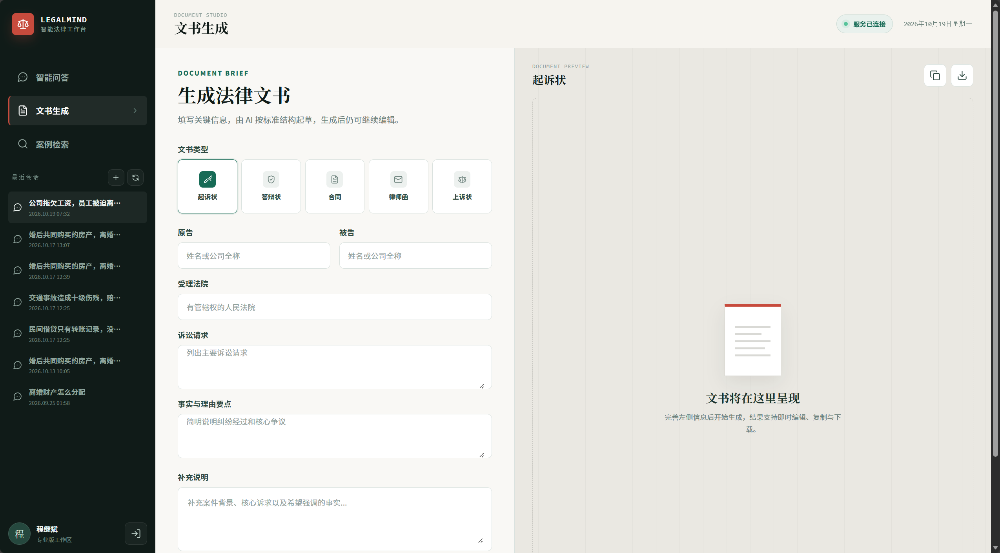
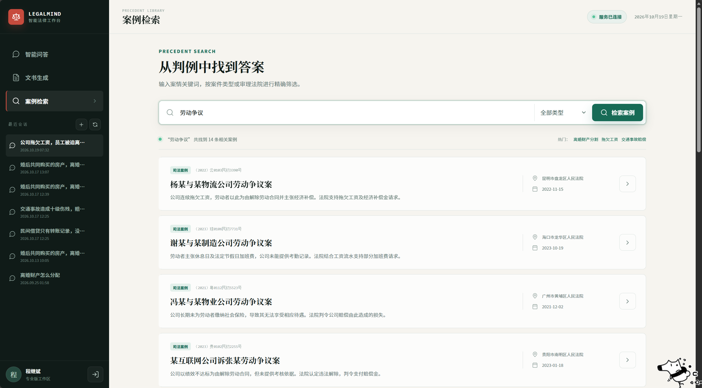

# LegalMind 法律智能助手

面向法律咨询场景的智能助手：后端基于 FastAPI 与 LangGraph 编排工作流，结合 RAG、ChromaDB、BGE 与 BM25 完成案例检索，支持 SSE 流式问答、法律文书生成和案例检索。

前端使用原生 JavaScript 与 HTML/CSS，零构建、零运行时依赖；数据层采用 PostgreSQL + Tortoise ORM，认证使用 JWT，整体可通过 Docker Compose 一键启动。

## 技术栈

| 层级       | 技术                                  |
| ---------- | ------------------------------------- |
| 后端       | Python、FastAPI、LangGraph、LangChain |
| 检索增强   | RAG、ChromaDB、BGE、BM25              |
| 数据与认证 | PostgreSQL、Tortoise ORM、JWT         |
| 流式交互   | SSE                                   |
| 前端       | JavaScript、HTML/CSS                  |
| 部署       | Docker Compose                        |

## 功能展示

### 用户注册与登录

支持账号注册与登录。注册时填写用户名、昵称、邮箱和密码，登录后进入独立的法律工作区，会话记录与文书结果按用户隔离。



### 智能问答

输入法律问题后，回答通过 SSE 流式输出，逐字呈现分析过程与法律依据；右侧同步展示本轮引用的案件、案号、审理法院和裁判日期，历史会话可随时恢复。



### 文书生成

支持起诉状、答辩状、合同、律师函和上诉状五类文书。填写当事人、受理法院、诉讼请求和事实理由后流式起草，生成结果可直接编辑、复制或下载。



### 案例检索

按关键词检索案例，并可按案件类型筛选。结果展示案号、审理法院、裁判日期和案情摘要，点击可查看完整案例详情。



## 项目结构

```text
LEGAL_MIND/
├── backend/                    # FastAPI + LangGraph 后端
│   ├── app/
│   │   ├── api/                # 认证、聊天 SSE、文书生成、案例检索接口
│   │   ├── agents/             # 意图识别、检索、问答、文书与工作流编排
│   │   ├── db/                 # Tortoise ORM 初始化与连接管理
│   │   ├── llm/                # LLM 客户端、提示词、Postgres checkpointer
│   │   ├── models/             # 用户、案例、会话、文书数据模型
│   │   ├── rag/                # Embedding、向量库、检索与重排
│   │   ├── scripts/            # seed_cases.py 与 build_index.py
│   │   ├── services/           # 案例查询服务
│   │   ├── test/               # 后端测试
│   │   ├── utils/              # 密码哈希与 JWT 工具
│   │   ├── config.py           # 环境变量配置
│   │   └── dependencies.py     # 当前用户认证依赖
│   ├── main.py                 # FastAPI 入口与 lifespan
│   ├── pyproject.toml          # 后端依赖定义
│   ├── uv.lock                 # 依赖版本锁定
│   ├── .python-version         # Python 版本
│   └── .env.example            # 环境变量模板
├── frontend/                   # 原生 JS 单页前端
│   ├── src/                    # 页面逻辑与 SSE 解析
│   ├── tests/                  # 前端单元测试
│   ├── index.html
│   ├── styles.css
│   ├── server.mjs              # 零依赖静态文件服务器
│   └── package.json
├── docs/images/                # README 功能截图
├── docker-compose.yml          # PostgreSQL + Redis
├── README.md
└── .gitignore
```

请求链路：

```text
浏览器 → frontend/src/app.js（发起 SSE 请求）
      → backend/app/api/chat.py（返回 text/event-stream）
      → app/agents/work_flow.py（意图识别 → 案例检索 → 问答生成）
      → PostgreSQL（会话记忆）+ ChromaDB（案例向量检索）
```

## 环境要求

- Python 3.12+
- [uv](https://docs.astral.sh/uv/)
- Node.js 18+ 与 Yarn
- Docker Desktop（用于 PostgreSQL 和 Redis）

## 启动依赖服务

在仓库根目录执行：

```powershell
docker compose up -d
```

PostgreSQL 映射到宿主机 `5433` 端口，Redis 使用 `6379` 端口。

## 启动后端

```powershell
cd backend
Copy-Item .env.example .env
uv sync
uv run main.py
```

`uv sync` 会按 `pyproject.toml` 和 `uv.lock` 创建或更新 `.venv` 并安装全部依赖；`uv run` 也会自动完成这一步，首次启动前显式执行一次更直观。

首次运行前在 `.env` 中填写 `LLM_API_KEY`，并按需修改 `SECRET_KEY`。后端默认监听 `http://localhost:8000`，接口文档位于 `http://localhost:8000/docs`。

首次使用时导入示例案件并构建向量索引：

```powershell
cd backend
uv run python -m app.scripts.seed_cases
uv run python -m app.scripts.build_index
```

`build_index` 会使用 `BAAI/bge-small-zh` 生成向量。若本地 `models/bge-small-zh` 不存在，会自动从 HuggingFace 下载到用户缓存目录（Windows 默认为 `%USERPROFILE%\.cache\huggingface`），不会写入 `models/`。

如需把模型固定到本地、方便离线运行，可以先执行：

```powershell
uv run python -m app.scripts.download_model
```

下载完成后模型会保存在 `backend/models/bge-small-zh`，后续启动会优先使用本地模型。

## 启动前端

```powershell
cd frontend
yarn install
yarn dev
```

浏览器访问 `http://localhost:5173`。前端默认请求 `http://localhost:8000/api`。
